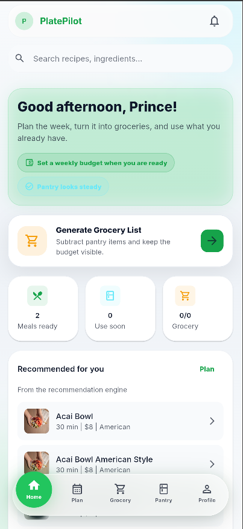
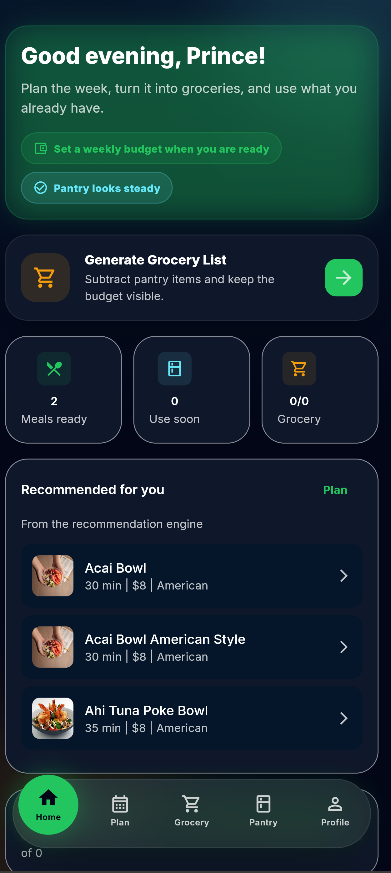
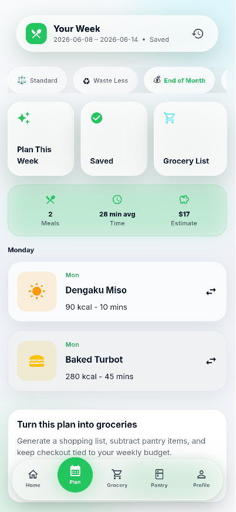
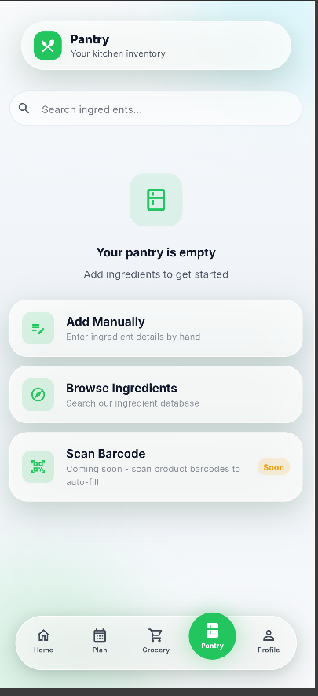
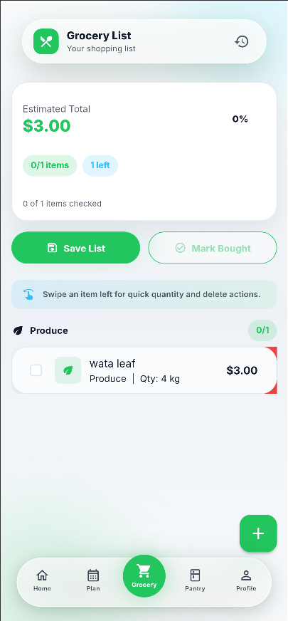
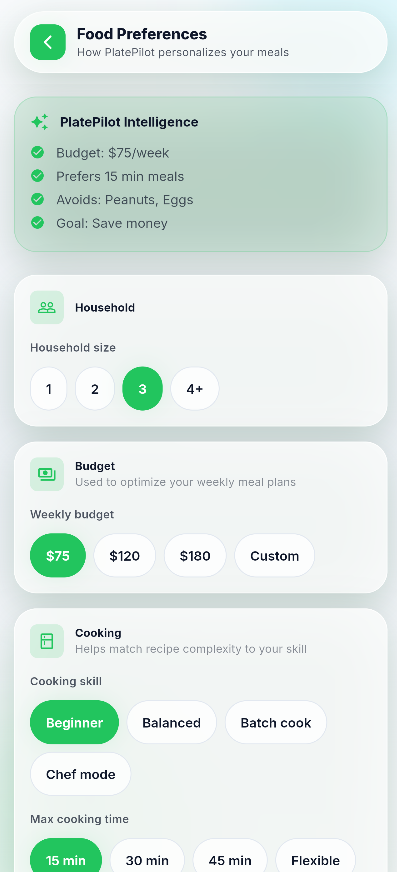

# 🍽️ PlatePilote

> Planifie tes repas, gère ton garde-manger et génère ta liste de courses depuis une seule application mobile.

[](https://github.com/tameze-prince/PlatePilote/actions/workflows/ci.yml)


[](LICENSE)

🌐 [Landing page](https://landing-page-five-orcin-81.vercel.app)

## Aperçu

| Accueil (clair) | Accueil (sombre) | Planning des repas |
|---|---|---|
|  |  |  |

| Garde-manger | Liste de courses | Préférences |
|---|---|---|
|  |  |  |

## Fonctionnalités

- Onboarding et préférences alimentaires
- Planning de repas
- Garde-manger (inventaire des produits)
- Liste de courses : ajout manuel et modification des articles
- Thèmes clair et sombre
- Profil et paramètres

## Stack technique

| Couche | Technologies |
|---|---|
| Application mobile | Flutter (`FrontEnd/`) |
| API | Java, Spring Boot, Maven (`BackEnd/`) |
| Base de données | PostgreSQL |
| Infrastructure | Docker, GitHub Actions, déploiement (`deploy/`) |
| Landing page | Vercel (`landing/`) |

## Structure du dépôt

```
PlatePilote/
├── FrontEnd/            Application Flutter
├── BackEnd/             API Spring Boot (+ Dockerfile, docker-compose)
├── landing/             Site vitrine
├── deploy/              Configuration de déploiement
├── scripts/             Scripts utilitaires
├── food_dataset_v2/     Jeu de données alimentaires
├── docs/                Documentation (marque, légal, sécurité, release…)
│   └── assets/          Logos et captures d'écran
└── .github/workflows/   Intégration continue
```

## Démarrage rapide

### API

```bash
cd BackEnd
cp .env.example .env        # puis renseigner les valeurs
docker compose up -d        # base de données
./mvnw spring-boot:run
```

### Application mobile

```bash
cd FrontEnd
flutter pub get
flutter run
```

### Tests

```bash
cd BackEnd  && ./mvnw test
cd FrontEnd && flutter analyze && flutter test
```

## Documentation

- [API (BackEnd/README.md)](BackEnd/README.md)
- [Plan de release APK](docs/APK_RELEASE_PLAN.md)
- [Stratégie de sauvegarde](docs/BACKUP_STRATEGY.md)
- [Configuration SSL](docs/SSL_SETUP.md)
- [Historique du projet](docs/HISTORY.md)

## Feuille de route

- [ ] Tests d'intégration (Testcontainers côté API, `integration_test` côté Flutter)
- [ ] Conformité RGPD, confidentialité et EU AI Act
- [ ] CI/CD complète et distribution de la bêta (Firebase)
- [ ] Télémétrie, analytique et guide des bêta-testeurs

## Licence

Le code est publié sous licence [MIT](LICENSE).
Le nom « PlatePilote » et son identité visuelle (logos, charte graphique) ne sont pas couverts par cette licence.

## Auteur

**ZEUFACK TAMEZE Prince** · [@tameze-prince](https://github.com/tameze-prince)